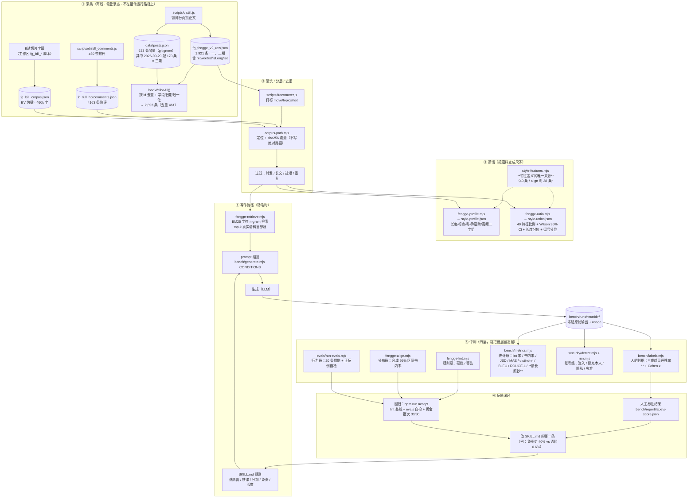
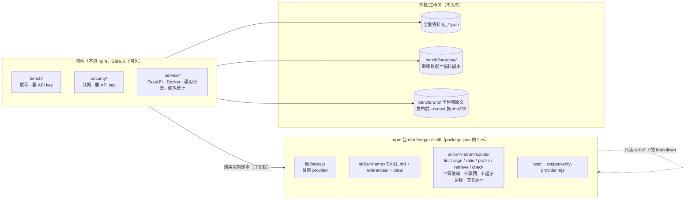
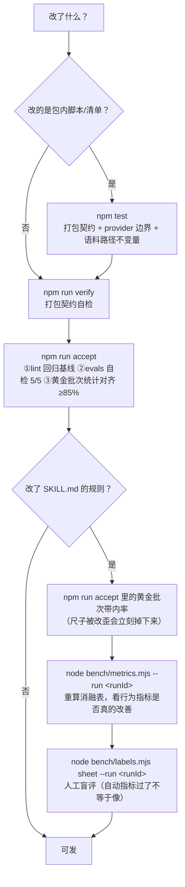

# 架构：从语料到"能验收的写作规则"

这份文档画三张图，分别回答三个问题：**数据怎么流**、**什么东西在包里**、**改了东西怎么知道没变坏**。
图里的每个框都是仓库里真实存在的东西，标了文件名；没有"规划中"的框混在里面。

---

## 一、全链路

**读法**：闭环是从 ⑥ 回到 ④ 的**一条人工回路**——机器只负责把偏差指到具体特征（"免责句 40% vs 语料 0.6%"），
改不改、怎么改由人定，改完必须过 ⑤ 的全部回归。这条回路上没有任何一步是自动改规则的，这是刻意的。

---

## 二、包里 / 包外（这条边界不能糊）

**规则**：任何**联网、要 key、起子进程**的东西一律在包外。
包内脚本只做纯本地计算（正则、统计、BM25），所以 `fengge-check.mjs` 当初才会把 spawn 子进程
改成直接 import——那不只是"更好的实现"，是**商店 fail-closed 门禁唯一能过的方式**。

---

## 三、改动 → 回归（决定"能不能发"）

**为什么不是"CI 绿了就能发"**：`accept` 只能证明"没退化"，
证明不了"更像人"。改规则这件事的最终验收永远落在 ⑥ 的人工盲评上——
而且要看胜率的 Wilson 区间，区间跨过 50% 就是**分不出**，不能宣布胜利。

---

## 四、几个容易被忽略的设计约束

| 约束 | 为什么 | 在哪体现 |
|---|---|---|
| 特征定义只有一份 | ratio 与 align 曾各抄一份（40 条 vs 28 条），改一处忘一处会"基准说 A、对齐判 B" | `style-features.mjs` + `selfcheck()` |
| 语料路径不许写死 | 写死本机路径时 `align/accept` 换机器就崩，所以一直进不了 CI | `corpus-path.mjs` + `test/corpus-path.test.mjs` |
| 派生统计随仓库走 | align 要的逗号分位不再回读语料，它才能变成纯函数进 CI | `style-ratios.json` 的 `comma` 段 |
| 溯源写 sha256 不写路径 | 把作者本机路径写进随仓库分发的 data/*.json 既泄漏又不可复现 | `provenance()` |
| 抽不到就抛错 | LCG 低位退化让"抽 20 条"静默只给 16 条，100 条评测集变 96 条 | `sampleIndices` |
| 推理统一关闭 | `deepseek-flash` 默认思考，一次调用 176 个输出 token 里 167 个是推理，极端情况下正文一个字都不剩（实测 3/9 条空输出） | `generate.mjs` 的 `thinking:{type:'disabled'}` |
| 发布前脱敏检索原文 | c2 档记录会带 240 条真实语料，等于把语料复制进仓库 | `generate.mjs --redact` |
